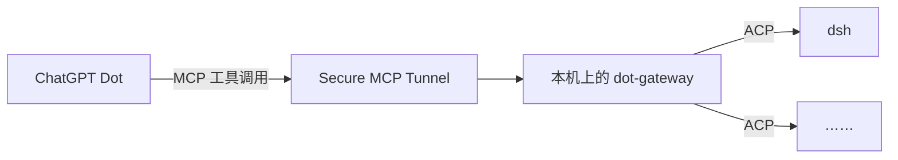

# dot-gateway

让 ChatGPT Dot 通过 OpenAI Secure MCP Tunnel，跟本机的编码 agent（默认是 DeepSeek Harness `dsh --profile acp`）进行**多轮会话**。Dot 可以一轮接一轮地追问，agent 会记得上下文；网关重启、机器重启以后，用同一个 `sessionId` 还能接着聊。

## 架构



Dot 只会 MCP，网关负责翻译：对上用 MCP 和 Dot 说话，对下用 ACP（Agent Client Protocol）和各个 agent 说话。工具照 ACP 会话动作命名，任何走 stdio 的 ACP agent 写进配置就能接入。

## 快速开始

```sh
cd ~/Workspace/dot-gateway
uv sync
scripts/start.sh          # 前台运行，监听 http://127.0.0.1:8765/mcp（Streamable HTTP）
uv run pytest -q          # 单元测试，用假 agent，不花钱
```

tunnel-client 用 `--mcp-server-url http://127.0.0.1:8765/mcp` 连过来。部署、开机自启、配置项和技术细节见 [AGENTS.md](AGENTS.md)。

## 工具

| 工具 | 作用 |
|---|---|
| `start_session(cwd, prompt?)` | 开一个会话；带 prompt 时发出去就返回，不等跑完 |
| `prompt(sessionId, text)` | 同一个会话的下一轮；一轮没结束再调会返回 `SESSION_BUSY` |
| `get_events(sessionId, view?)` | 轮询结果。默认 `view=final`：只给状态，这一轮结束时给一次最终答复；`messages` 给合并后的整条消息和一行一个的工具调用；`full` 给原始事件 |
| `get_tool_call(sessionId, toolCallId)` | 某次工具调用的完整输入和输出 |
| `get_session` / `list_sessions` | 会话概况；`detail=full` 带每一轮的完整答复 |
| `load_session` | 接回会话（dsh 用 `session/resume`） |
| `cancel_prompt` / `close_session` | 中断这一轮 / 结束会话 |
| `set_config_option`、`resolve_permission`、`list_agents` | 切换模型等配置、回答权限请求、列出 agent |

返回值都是一段紧凑的 JSON。最终答复只投递一次，如果没收到，传 `includeText=true` 或调 `get_session(detail="full")` 可以再取一次。

网关不加安全限制：权限策略（默认 `read_only`）只决定网关怎么回答 agent 的权限请求，调用方每一轮都可以调高。

## 许可证

[MIT](LICENSE)
